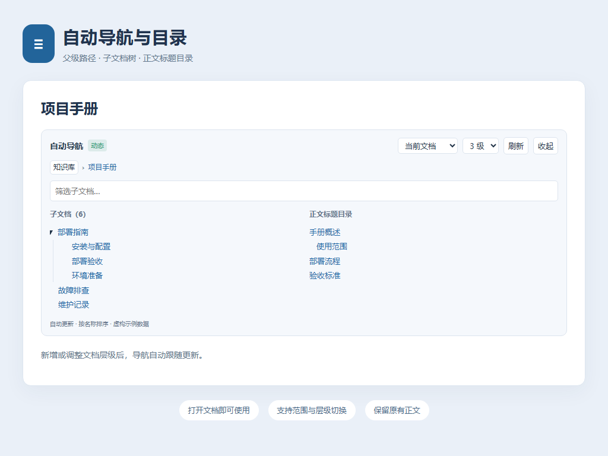

# Automatic Navigation for SiYuan

Read-only parent breadcrumbs, child document tree and heading outline, automatically displayed below the document title. Newly opened documents do not need a widget inserted manually.

[简体中文](README.zh-CN.md)



## Features

- Navigate to ancestors, descendants or headings.
- Switch between document, notebook and workspace scopes.
- Choose 1–6 levels and filter document names.
- React to document changes, with a five-second fallback while the editor is visible. Indexing can add a short delay.
- Preserve original note content. The panel lives outside the editable body and disappears when disabled.

## Install

After this repository is accepted by the SiYuan community bazaar, search for **Automatic Navigation** in Settings → Bazaar → Plugins and enable it.

For manual installation, extract the release `package.zip` into `WORKSPACE/data/plugins/siyuan-auto-navigation/`; the directory must directly contain `plugin.json` and `index.js`. Enable the plugin in SiYuan. If SiYuan asks whether to trust bazaar content, review and confirm this yourself.

## Usage and limits

Open a document to see the navigation panel. Use Refresh for an immediate update or Collapse to save space. Scope and depth are stored locally for each document. Child documents are sorted naturally by name; the plugin does not alter the document tree's manual ordering. Headings follow physical document order.

SiYuan **3.8.11+**, desktop frontends only. Integration was tested with the Windows 3.8.11 kernel and browser desktop frontend; Linux/macOS and detached windows have not been separately verified. The interface currently uses Simplified Chinese.

Closed or locked encrypted notebooks are excluded. Existing static navigation lists are not removed or maintained. The plugin does not classify documents, rewrite technical content or create persistent directory blocks.

## Privacy

Runtime requests go only to the same-origin SiYuan API. The plugin reads titles, hierarchy and headings in accessible open notebooks. No analytics, cloud service or outbound network destination is included. It does not create, update, move or delete notes. Preferences contain document identifiers, scope and depth and stay in the frontend's local storage.

## Development

Node.js 20+ and Python 3.9+ are sufficient for core tests and builds; no build dependency needs downloading.

```sh
npm test
python tools/configure.py --owner YOUR_GITHUB_LOGIN
python tools/build.py
```

For browser integration tests, install development dependencies with `npm install`, then install Playwright Chromium with `npx playwright install chromium`, build the plugin, and run `npm run test:browser`. The tests use synthetic data only.

The build produces `dist/` and `release/package.zip`; the ZIP has its manifest at the root. Repository name must remain `siyuan-auto-navigation`. See [publishing steps](docs/PUBLISHING.md).

## License and implementation

MIT. Original implementation using the SiYuan plugin SDK and local API. Reference documentation: [plugin sample](https://github.com/siyuan-note/plugin-sample), [SiYuan API](https://github.com/siyuan-note/siyuan/blob/master/docs/API.md). No third-party runtime library is bundled.
