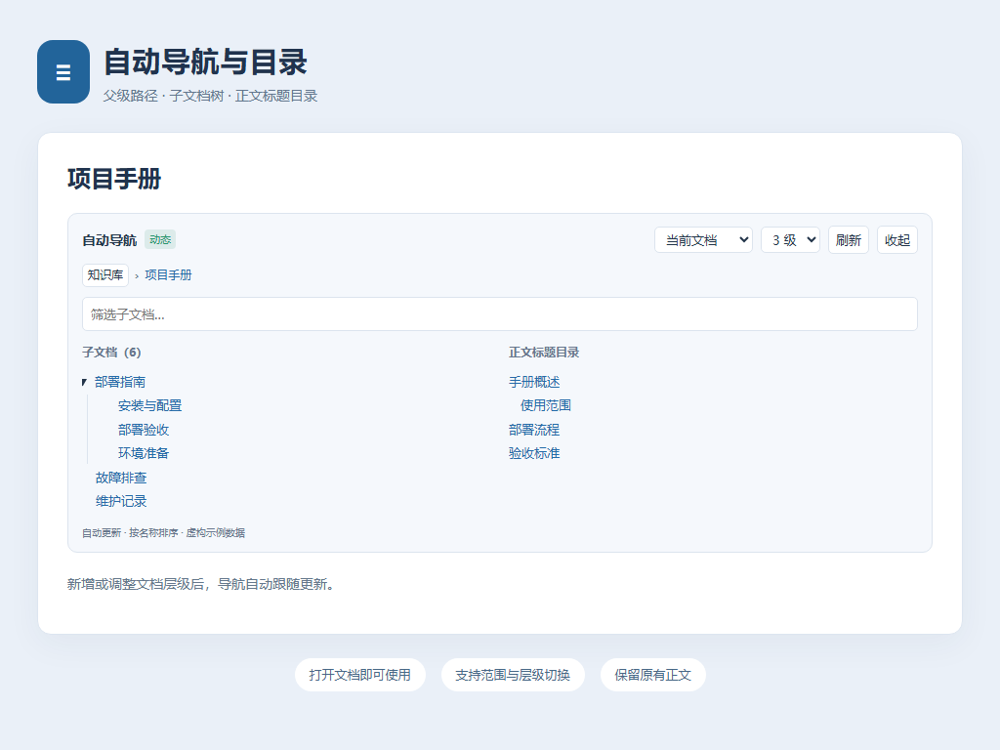

# 自动导航与目录

自动显示父级路径、子文档树和正文标题目录，打开新文档即可获得导航，无需逐页插入挂件。

[English](README.md)

## 功能

- 面包屑跳转父级文档，子文档树支持 1～6 级和名称筛选。
- 可切换当前文档、当前笔记本、全部笔记本范围。
- 正文标题按实际文档顺序显示，点击可定位。
- 事件驱动刷新，并每 5 秒检查可见编辑器；索引更新可能有额外短暂延迟。
- 导航面板位于正文编辑区之外，不改写原文，停用插件即可移除面板。

## 安装

集市审核通过后，可在“设置 → 集市 → 插件”中搜索“自动导航与目录”并启用。

手动安装：将 Release 中的 `package.zip` 解压到当前工作空间的 `data/plugins/siyuan-auto-navigation/`，确保该目录直接包含 `plugin.json`、`index.js` 等文件，再到思源插件设置启用。如出现集市信任提示，请阅读后由你本人决定是否确认。

## 使用及兼容性

打开任意文档，标题下方自动显示导航。可点击刷新、收起，切换范围及层级。范围和层级按文档保存在当前前端本地存储中。

最低思源版本：3.8.11。面向桌面前端；已实测 Windows 3.8.11 内核及浏览器桌面前端。Linux、macOS 和独立窗口尚未单独验收，移动端暂不声明支持。

子文档按名称自然排序，不改变文档树的手工排序。已关闭或未解锁的加密笔记本不列入目录。此插件不清理旧的静态目录、不做 AI 分类或补写资料，也不把导航写成永久正文块。当前界面文字为简体中文。

## 隐私

运行时仅访问同源思源 API，读取可访问笔记本中的文档标题、层级及标题目录。没有统计、云服务或外部网络请求；不创建、修改、移动或删除笔记。偏好仅保存文档标识、范围和层级，不上传。

## 开发

Node.js 20+、Python 3.9+。运行 `npm test` 执行核心测试；运行 `python tools/configure.py --owner 你的GitHub账号` 配置仓库地址，然后执行 `python tools/build.py`，生成 `release/package.zip`。

浏览器测试需安装开发依赖及 Playwright Chromium，详见英文说明。公开演示与测试只使用虚构数据。

MIT 开源许可；实现未打包第三方运行库。发布流程见 [PUBLISHING](docs/PUBLISHING.md)。
